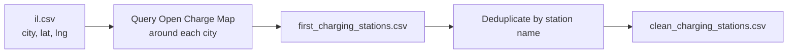

# EV_stations_Israel

Builds one deduplicated CSV of EV charging stations in Israel from the Open Charge Map API.

## The problem

I needed a flat list of public EV chargers in Israel with coordinates. Open Charge Map's search API answers "stations near this point" and limits the number of results per call, so a single query misses most of the country.

## What I built

A script that walks a list of Israeli cities, queries the API around each one, and merges the results into a clean file with name, latitude, longitude and address.

## Architecture



## Design decisions

- Cover the country with many overlapping city queries instead of one large one. Overlap is cheap, missing stations is not.
- Write raw results first and deduplicate in a second pass. If a request fails halfway, the raw file still has everything fetched so far.
- The API key comes from the `OCM_API_KEY` environment variable, not from the source.

## Setup

```bash
python3 -m venv .venv && .venv/bin/pip install -r requirements.txt
```

You need two things that are not in the repo:

- A free API key from [Open Charge Map](https://openchargemap.org/site/develop/api)
- `il.csv`, a list of Israeli cities with the city name, latitude and longitude in the first three columns. The free Israel cities file from simplemaps.com has that layout.

## Run

```bash
OCM_API_KEY=your-key .venv/bin/python main.py
```

The result is `clean_charging_stations.csv`.

## Limits

Deduplication is by station title, so two different stations with the same name collapse into one.
